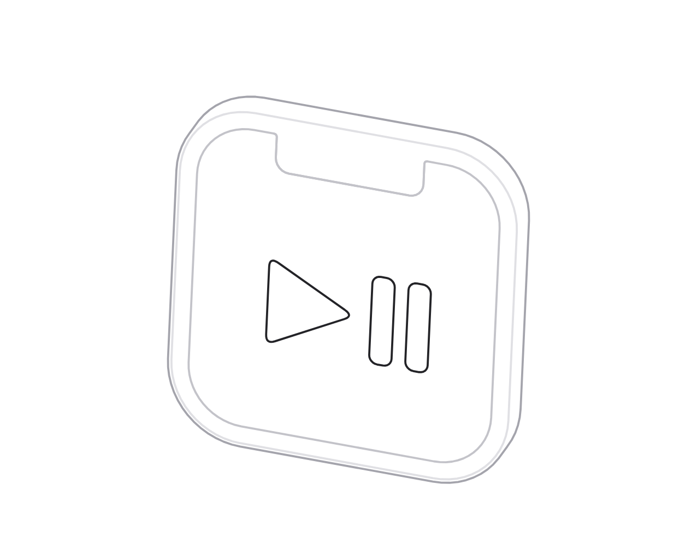

<picture>
  <source media="(prefers-color-scheme: dark)" srcset="docs/hero-dark.png">
  
</picture>

# NotchTV

Click your MacBook's notch to play or pause your Apple TV.

Hover over the notch and it widens: your Apple TV on the left, and on the right what a
click will do, ⏸ while something is playing or ▶ when it's paused. It stays right even
when you use the Siri Remote.


## Install

1. Download `NotchTV-<version>.dmg` from the [latest release](../../releases/latest), open it
   and drag NotchTV to Applications.
2. Open NotchTV. When macOS asks whether NotchTV may find devices on your local network,
   choose **Allow**.
3. Click the notch. Your Apple TV shows a PIN. Type it in, then type the second PIN that
   follows (one is for sending commands, the other for knowing what's playing).

NotchTV has no Dock icon or window. It opens at login, and you can turn that off in its menu.

## Use

| | |
|---|---|
| **Hover** the notch | See which TV it controls and what a click will do |
| **Click** | Play or pause |
| **Right-click** (or Control-click) | The current TV, *Pair…* for any unpaired TV, *Open at Login*, *Quit* |

**More than one place?** Pair each Apple TV once while you're on its network. NotchTV
always uses whichever paired Apple TV is on the network you're on, and switches by itself
when you move between networks.

## Requirements

- A Mac with a notch: MacBook Pro (14-inch or 16-inch, 2021 or later) or MacBook Air (2022 or later)
- macOS 14 or later (built and tested on macOS 27)
- An Apple TV on the same network (tested with Apple TV 4K)

## Privacy

Everything stays between your Mac and your Apple TV. NotchTV collects nothing and talks to
nothing else. The keys from pairing are kept in
`~/Library/Application Support/NotchTV/pairings.json` and never leave your Mac.

## Troubleshooting

- **"No Apple TV"**: make sure the Mac and the Apple TV are on the same network, and that
  NotchTV is allowed in System Settings › Privacy & Security › Local Network.
- **Pairing failed**: click the notch (or right-click › *Pair…*) and try again. The PIN
  changes every time.
- A log is kept at `~/Library/Logs/NotchTV.log`.

## How it works

A small AppKit app draws an overlay exactly over the notch, sized from the screen's
unobscured top areas, so clicks there reach it instead of the menu bar. It runs a bundled
Python helper that talks to the Apple TV with [pyatv](https://github.com/postlund/pyatv):
the Companion protocol sends play and pause, and the AirPlay tunnel reports what's playing.
The helper keeps one connection open, so a click takes a single round trip.

## Build from source

You need Xcode (or its command line tools) and [uv](https://docs.astral.sh/uv/).

```bash
scripts/build.sh
```

That builds the app with its own Python, signs it ad hoc, installs it in Applications and
opens it. Releases are signed with a Developer ID and notarized:

```bash
SIGN_IDENTITY="Developer ID Application: Your Name (TEAMID)" NOTARY_PROFILE=your-profile scripts/release.sh
```

## License

MIT, see [LICENSE](LICENSE). The app bundles Python and several open-source packages; their
licenses are in `NotchTV.app/Contents/Resources/ThirdPartyLicenses.txt`.

The illustration is a [Hairline](https://hairline.lucasmarkes.com) figure; its source is
`docs/hairline/notchtv.js`.

NotchTV isn't affiliated with Apple. Apple TV is a trademark of Apple Inc.
